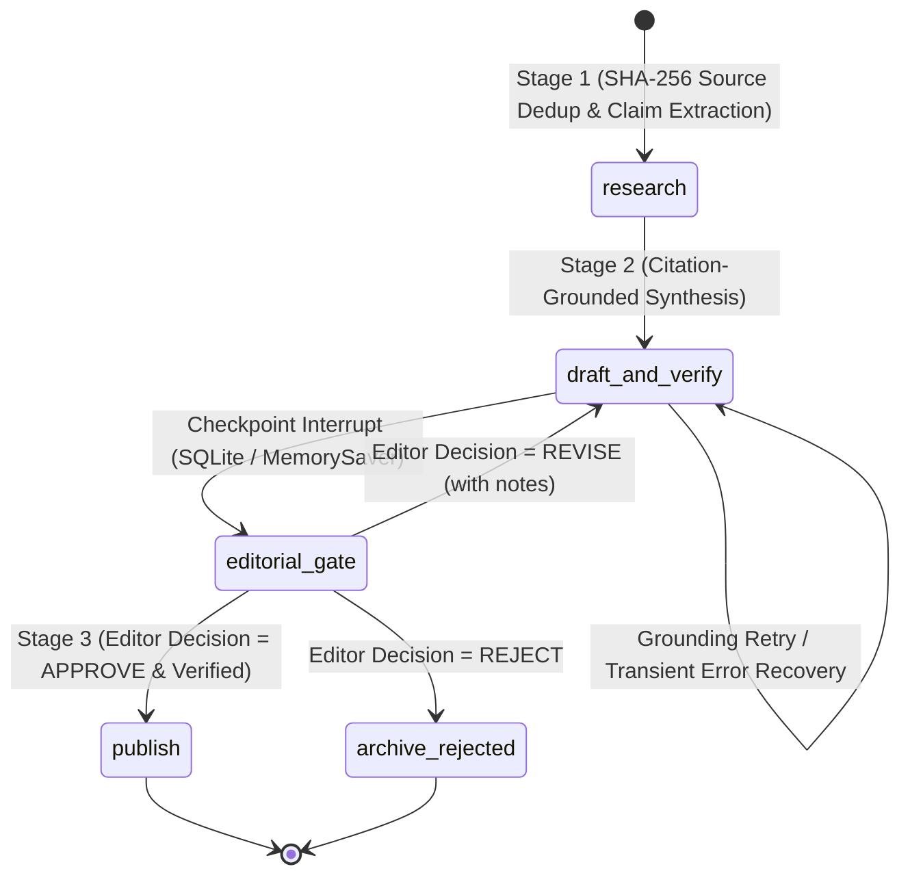

# LangGraph Newsroom

Deterministic **3-stage news production pipeline** built on **LangGraph** with **human-in-the-loop (HITL) approval gates**, **durable SQLite checkpointing**, **citation/numeric grounding verification**, and **bounded error recovery**.

## Architecture

Unconstrained editorial pipelines risk publishing uncorroborated statistics or losing state when an upstream model call times out mid-workflow. **LangGraph Newsroom** compiles editorial production into an explicit `StateGraph` (`src/newsroom/pipeline.py`) that suspends execution at `interrupt_before=["editorial_gate"]` and blocks publication unless every paragraph carries verified `[SRC-*]` provenance and grounded numeric tokens:



### Key Capabilities

- **Stage 1 — Source Deduplication & Atomic Claim Extraction (`_stage1_research`):** Normalizes primary `SourceDocument` records, deduplicates repeated wire feeds via canonical `SHA-256` digests, and extracts provenance-linked `ExtractedClaim` units.
- **Stage 2 — Citation-Grounded Synthesis & Numeric Verification (`_stage2_draft_and_verify` + `verifier.py`):** Verifies `100%` paragraph citation coverage, flags unknown `[SRC-*]` tags or uncorroborated numbers (`verify_draft_grounding`), and recovers automatically from transient draft-generator failures with bounded retry budgets.
- **Stage 3 — Checkpointed Human Approval Gate (`interrupt_before=["editorial_gate"]`):** Persists graph state in `SqliteSaver` so human editors can inspect risk flags across process restarts and resume threads with `approve`, `revise` (looping back to Stage 2 with revision notes), or `reject` — while code-enforcing `blocked_unverified_draft` if an unverified draft is ever forced toward publication.

## Quickstart

```bash
python3 -m venv .venv && source .venv/bin/activate
pip install -e ".[dev]"

ruff check src tests
mypy src tests
pytest
newsroom --db-path /tmp/newsroom.sqlite3
```

## REST API (`FastAPI`)

- `POST /runs` — Start a 3-stage newsroom run and pause cleanly at the human approval checkpoint.
- `GET /runs/{thread_id}` — Inspect checkpointed draft, citation coverage, and verification risk flags.
- `POST /runs/{thread_id}/decision` — Resume from checkpoint with `approve`, `revise`, or `reject`.

## Author & License

Authored by **Nagarjuna Kamireddy** ([writetonagarjuna@gmail.com](mailto:writetonagarjuna@gmail.com) · [GitHub](https://github.com/nagarjunak-pixel) · [LinkedIn](https://www.linkedin.com/in/nagarjuna-kamireddy)). Released under the **Apache-2.0 License**.
